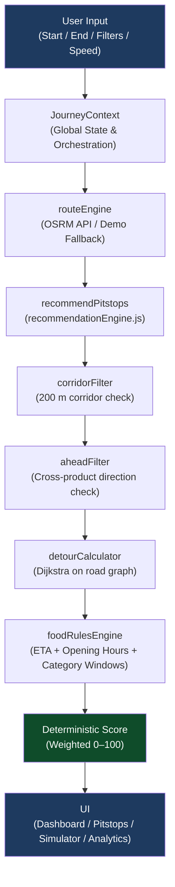

# 🛣️ WayDine — Smart Pitstop Intelligence for Mumbai → Pune

> **Hackathon Demo** · React 18 + Vite 5 · No AI/ML · Pure graph algorithms + geospatial math

WayDine ranks restaurants along the Mumbai–Pune expressway by how **genuinely convenient** they are for a driver in motion — factoring in detour distance, road accessibility, direction of travel, ETA, and food availability. Every score is deterministic and fully explainable.

---

## Table of Contents

- [Overview](#overview)
- [Stack](#stack)
- [Architecture](#architecture)
- [Hackathon Tasks](#hackathon-tasks)
- [Algorithms](#algorithms)
- [Data Sources](#data-sources)
- [Setup](#setup)
- [Demo Flow (Judge Walkthrough)](#demo-flow-judge-walkthrough)
- [Expected Demo Results](#expected-demo-results)
- [Task → Feature → File Mapping](#task--feature--file-mapping)
- [Environment Variables](#environment-variables)
- [Limitations](#limitations)

---

## Overview

WayDine solves a real driver problem: *"Which restaurant should I stop at without wasting time on a detour, a U-turn, or a place that's already closed?"*

It does this with **three layered algorithms**:

1. **Route-aware, direction-aware discovery** — only shows restaurants that are actually reachable from your lane, in the direction you're traveling.
2. **Detour and U-turn minimization** — runs Dijkstra on a real road graph (with U-turn penalties) to compute actual detour cost, not straight-line guesses.
3. **ETA-based food recommendation** — uses your vehicle speed and remaining distance to predict when you'll arrive at each restaurant, then checks opening hours and food-category windows to score suitability.

> [!IMPORTANT]
> WayDine uses **zero AI/ML**. All rankings are produced by graph algorithms and geospatial math with configurable, auditable weights.

---

## Stack

| Layer | Technology |
|---|---|
| Frontend framework | React 18 + Vite 5 (ES modules, JavaScript only) |
| Styling | Tailwind CSS (dark navy premium design) |
| Map | React-Leaflet + OpenStreetMap tiles (no API key required) |
| Routing API | OSRM public API (no API key) + offline demo fallback |
| Charts | Recharts |
| Testing | Vitest (50 tests, all passing) |
| Backend (optional) | Supabase (behind env vars — app works fully without it) |

---

## Architecture



### Directory Structure

```
src/
├── engine/                        # Pure functions — no React, no network calls
│   ├── geoUtils.js                # haversine, bearing, point-to-segment, cross-product, progress-along-route
│   ├── routeEngine.js             # buildSegments, fetchOsrmRoute, getRoute (OSRM + demo fallback)
│   ├── restaurantFilter.js        # corridorFilter, aheadFilter
│   ├── shortestPath.js            # Dijkstra with binary min-heap, one-way edges, U-turn restrictions
│   ├── detourCalculator.js        # calculateDetour, classifyDetour, U-turn/turn counting
│   ├── foodRulesEngine.js         # computeEta, isOpenAt, getActiveCategories, evaluateFoodSuitability
│   ├── recommendationEngine.js    # recommendPitstops, buildTemplatedExplanation, DEFAULT_WEIGHTS
│   └── validators.js              # isValidLatLng, assertPositiveNumber, assertWeightsSumTo100
│
├── data/
│   ├── LocalSeedRepository.js     # Default: reads JSON seed, persists to localStorage
│   ├── SupabaseRepository.js      # Optional: enabled if VITE_SUPABASE_URL + VITE_SUPABASE_ANON_KEY set
│   ├── restaurantRepository.js    # getRepository() factory
│   ├── mumbaiPuneSeed.json        # 12 benchmark restaurants (Sample/Demo)
│   └── repositoryInterface.js     # JSDoc contract
│
├── types/typedefs.js              # JSDoc @typedef for all data shapes
├── utils/indiaDefaults.js         # INR formatting, IST time, distance, road-side labels
├── context/JourneyContext.jsx     # Global state, engine orchestration
│
├── pages/
│   ├── LandingPage.jsx
│   ├── Dashboard.jsx
│   ├── PitstopsPage.jsx
│   ├── RestaurantDetailPage.jsx
│   ├── SimulatorPage.jsx
│   ├── AnalyticsPage.jsx
│   ├── PreferencesPage.jsx
│   ├── SettingsPage.jsx
│   ├── LoginPage.jsx
│   └── NotFoundPage.jsx
│
├── components/
│   ├── dashboard/                 # JourneyPlanner, DashboardMap, JourneySummary
│   ├── Sidebar.jsx
│   ├── Header.jsx
│   ├── RestaurantCard.jsx
│   ├── ScoreBreakdownModal.jsx
│   ├── Toast.jsx
│   ├── ErrorBoundary.jsx
│   ├── SkeletonLoader.jsx
│   └── FilterControls.jsx
│
supabase/schema.sql                # Full Supabase schema with RLS and PostGIS
test/
├── engine.test.js
├── phase1.test.js
└── phase2.test.js                 # 50 tests total
```

---

## Hackathon Tasks

### Task 1 — Route-Aware, Direction-Aware Discovery

Every restaurant is classified into one of four accessibility tiers:

| Class | Meaning |
|---|---|
| 🟢 **GREEN** | On the correct carriageway, within corridor, ahead of vehicle |
| 🟡 **YELLOW** | Reachable via legal U-turn at a junction |
| 🔴 **RED** | Opposite carriageway with median barrier — not safely reachable |
| ⬜ **UNVERIFIED** | No road-graph data available for this location |

**How it works:**
- **Corridor filter**: perpendicular distance from restaurant to nearest route segment ≤ 200 m.
- **Ahead check**: cross-product of `(segEnd − segStart) × (restaurant − segStart)` — sign determines if the restaurant is ahead or behind the vehicle's current position.
- **Accessibility classification**: road-graph lookup + lane analysis in `detourCalculator.js`.

Key files: [`restaurantFilter.js`](src/engine/restaurantFilter.js), [`geoUtils.js`](src/engine/geoUtils.js), [`detourCalculator.js`](src/engine/detourCalculator.js)

---

### Task 2 — Detour and U-Turn Minimization

WayDine computes the **real road-network cost** of visiting each restaurant using Dijkstra on a hand-built road graph, not a simple straight-line approximation.

**Detour formula:**
```
detour = dist(vehicle → access point) + dist(access point → rejoin node) − remaining original route distance
```

U-turns and sharp turns carry configurable penalties (defaults: 500 m-equivalent for U-turns, 100 m-equivalent for turns), making the system actively prefer straight-in access points.

Key files: [`shortestPath.js`](src/engine/shortestPath.js), [`detourCalculator.js`](src/engine/detourCalculator.js), [`recommendationEngine.js`](src/engine/recommendationEngine.js)

---

### Task 3 — ETA-Based Food Recommendation

The engine computes a per-restaurant ETA using vehicle speed and remaining route distance, then evaluates:

1. **Is the restaurant open** at that ETA? (`isOpenAt`)
2. **Which food categories are active** at that time window? (`getActiveCategories`) — e.g., breakfast ends at 11 AM, lunch runs 12–3 PM.
3. **Does the restaurant serve food** suitable for that window? (`evaluateFoodSuitability`)

This produces a `food_availability_at_eta` sub-score that feeds directly into the final weighted score.

Key files: [`foodRulesEngine.js`](src/engine/foodRulesEngine.js), [`recommendationEngine.js`](src/engine/recommendationEngine.js), [`JourneyContext.jsx`](src/context/JourneyContext.jsx)

---

## Algorithms

### Haversine Distance

Computes straight-line distance between two lat/lng points on a sphere. Used for corridor membership checks.

$$d = 2R \cdot \arcsin\!\left(\sqrt{\sin^2\!\left(\frac{\Delta\varphi}{2}\right) + \cos\varphi_1 \cos\varphi_2 \sin^2\!\left(\frac{\Delta\lambda}{2}\right)}\right)$$

Where $R = 6{,}371$ km (Earth's mean radius), $\varphi$ = latitude in radians, $\lambda$ = longitude in radians.

---

### Point-to-Segment Distance

For corridor filtering, the engine computes the **perpendicular distance** from each restaurant to the nearest point on each route segment using local equirectangular projection. The projection result is clamped to the segment endpoints so the distance is never computed to a phantom point outside the segment.

---

### Cross-Product Bearing (Direction Awareness)

For the ahead-of-vehicle check, the engine computes:

```
cross = (segEnd − segStart) × (restaurant − segStart)
```

The **sign of the cross product** tells us whether the restaurant lies to the left or right of the route direction vector. Combined with the vehicle's `progressAlongRoute`, this reliably detects restaurants that are behind the current position — even on curved roads.

---

### Dijkstra's Shortest Path

A custom implementation using a **binary min-heap** for O((V + E) log V) performance. The graph respects:

- **One-way edges** (expressway carriageways)
- **U-turn restrictions** (configurable penalty: default 500 m-equivalent)
- **Turn penalties** (configurable: default 100 m-equivalent)

Returns `{ path, distance, time }` or `null` if the destination is unreachable from the vehicle's current carriageway.

---

### Detour Calculation

```
detour_distance = dijkstra(vehicle → access_point)
                + dijkstra(access_point → rejoin_node)
                − remaining_original_route_distance
```

All distances are computed on the **road graph** (not straight-line). U-turns and turns along the path are counted and their penalties are added before detour classification:

| Detour Class | Range |
|---|---|
| Excellent | < 300 m |
| Very Good | 300 – 700 m |
| Moderate | 700 m – 1.5 km |
| High | > 1.5 km |

---

### Deterministic Weighted Score

```
Score = 30% × detour_efficiency
      + 25% × direction_compatibility
      + 20% % road_accessibility
      + 15% × food_availability_at_eta
      + 10% × time_compatibility
```

All weights are **user-configurable** in `/settings` and must sum to 100. The score is always in the range 0–100 with no randomness or model inference.

> [!TIP]
> Open `/settings` to adjust weights live — the engine re-runs immediately and all rankings update across Dashboard, Pitstops, and Analytics.

---

## Data Sources

| Data | Source | Label in UI |
|---|---|---|
| Route geometry | OSRM public API (live) or bundled demo polyline (fallback) | "Live" / "Demo Fallback" |
| Road graph | Hand-built 14-node, ~20-directed-edge sample graph | Sample/Demo |
| Restaurants | 12 seed entries in `src/data/mumbaiPuneSeed.json` | Sample/Demo |
| Opening hours | Hardcoded in seed data | Sample/Demo |

---

## Setup

```bash
# 1. Install dependencies
npm install

# 2. Start development server
npm run dev

# 3. Run test suite (50 tests)
npm test
```

Open [http://localhost:5173](http://localhost:5173) — the landing page loads immediately with no configuration required.

> [!NOTE]
> Supabase is **entirely optional**. Without env vars set, the app uses `LocalSeedRepository` backed by `localStorage` and the bundled JSON seed. Everything works offline.

---

## Demo Flow (Judge Walkthrough)

Follow these steps in order for a complete feature demonstration:

| Step | Action | What to observe |
|---|---|---|
| 1 | Open app | Landing page with route preview |
| 2 | Click **"Plan Your Journey"** → Dashboard | Journey planner panel |
| 3 | Click **"Load Demo Journey"** | Mumbai → Pune, 148.5 km loaded |
| 4 | Inspect the map | 12 restaurants with GREEN / YELLOW / RED / UNVERIFIED pins |
| 5 | Check right panel | Top 3 picks with scores, detour distances, ETA |
| 6 | Navigate to `/pitstops` | Filter by cuisine, dietary preference, budget |
| 7 | Click any restaurant | `/restaurant/:id` — full Task 1 / 2 / 3 breakdown |
| 8 | Navigate to `/simulator` | Scrub vehicle position forward → rankings update live |
| 9 | Add 2–5 restaurants to comparison | "What-If" table: detour, ETA, score side-by-side |
| 10 | Select one restaurant | Journey impact shown: **+X min to Pune arrival** |
| 11 | Navigate to `/analytics` | KPI cards + 5 charts + selection history |
| 12 | Navigate to `/settings` | Adjust weights (must sum to 100) → engine re-runs |

---

## Expected Demo Results

> [!NOTE]
> All results are produced from the 12-restaurant sample dataset in `mumbaiPuneSeed.json`.

| Restaurant | Access Class | Detour Class | Key Reason |
|---|---|---|---|
| Cafe Kalamboli Express | 🟢 GREEN | Excellent | Direct access, 180 m detour |
| Highway King Dhaba | 🟢 GREEN | Very Good | Direct access, 450 m detour |
| Pune Misal House | 🟢 GREEN | Moderate | Direct access, 950 m detour |
| The Pit Stop Cafe | 🟡 YELLOW | Moderate | Legal U-turn at junction, 1.1 km |
| Mumbai Street Bites | 🟡 YELLOW | High | Long junction diversion, 2.1 km |
| Opposite Bites | 🔴 RED | — | Opposite carriageway, median barrier |
| Garden Veg Restaurant | ⬜ UNVERIFIED | — | No road-graph data |
| Highway Breakfast Spot | 🟢 GREEN | Excellent | Opens 6 AM, qualifies for breakfast ETA |
| Late Night Dhabha | 🟢 GREEN | Very Good | Closes 2 AM next day |
| The Biryani Stop | 🟢 GREEN | Moderate | Lunch not available at 11 AM ETA |
| Budget Bites Express | 🟢 GREEN | Excellent | ₹ tier, excellent access |
| Premium Highway Lounge | 🟢 GREEN | High | ₹₹₹ tier, longer approach road |

---

## Task → Feature → File Mapping

| Hackathon Task | Features | Key Files |
|---|---|---|
| **1. Route-aware discovery** | Corridor filter (200 m), ahead-of-vehicle check, GREEN/YELLOW/RED/UNVERIFIED classification | [`restaurantFilter.js`](src/engine/restaurantFilter.js), [`geoUtils.js`](src/engine/geoUtils.js), [`detourCalculator.js`](src/engine/detourCalculator.js) |
| **2. Detour minimization** | Dijkstra on road graph, U-turn detection, configurable turn penalties | [`shortestPath.js`](src/engine/shortestPath.js), [`detourCalculator.js`](src/engine/detourCalculator.js), [`recommendationEngine.js`](src/engine/recommendationEngine.js) |
| **3. ETA-based food** | Per-restaurant ETA, opening hours check, food-category time windows, weighted deterministic score | [`foodRulesEngine.js`](src/engine/foodRulesEngine.js), [`recommendationEngine.js`](src/engine/recommendationEngine.js), [`JourneyContext.jsx`](src/context/JourneyContext.jsx) |

---

## Environment Variables

All environment variables are optional. The app is fully functional without them.

```env
VITE_SUPABASE_URL=https://your-project.supabase.co
VITE_SUPABASE_ANON_KEY=your_anon_key
```

When both are set, `restaurantRepository.js` switches from `LocalSeedRepository` to `SupabaseRepository` automatically. The Supabase schema (with RLS policies and PostGIS) is in [`supabase/schema.sql`](supabase/schema.sql).

---

## Limitations

> [!WARNING]
> The following are known constraints of the hackathon demo and are clearly labelled "Sample/Demo" in the UI.

- **Road graph is hand-built** — 14 nodes, ~20 directed edges covering demo restaurant access points only. Not a production OSM graph.
- **Restaurants are sample data** — 12 seed entries, not live listings.
- **OSRM public API** is rate-limited and may respond slowly; the bundled demo fallback activates automatically.
- **Accessibility is UNVERIFIED** for any restaurant outside road-graph coverage.
- **No live opening hours** — all sourced from seed data.
- **No geocoding** — preset coordinates only; no free-text address search.
- **Supabase is optional** — the app works fully in offline/seed mode.

---

<p align="center">
  Built for a hackathon · Mumbai → Pune · Pure algorithms, no black boxes
</p>
# WayDine

