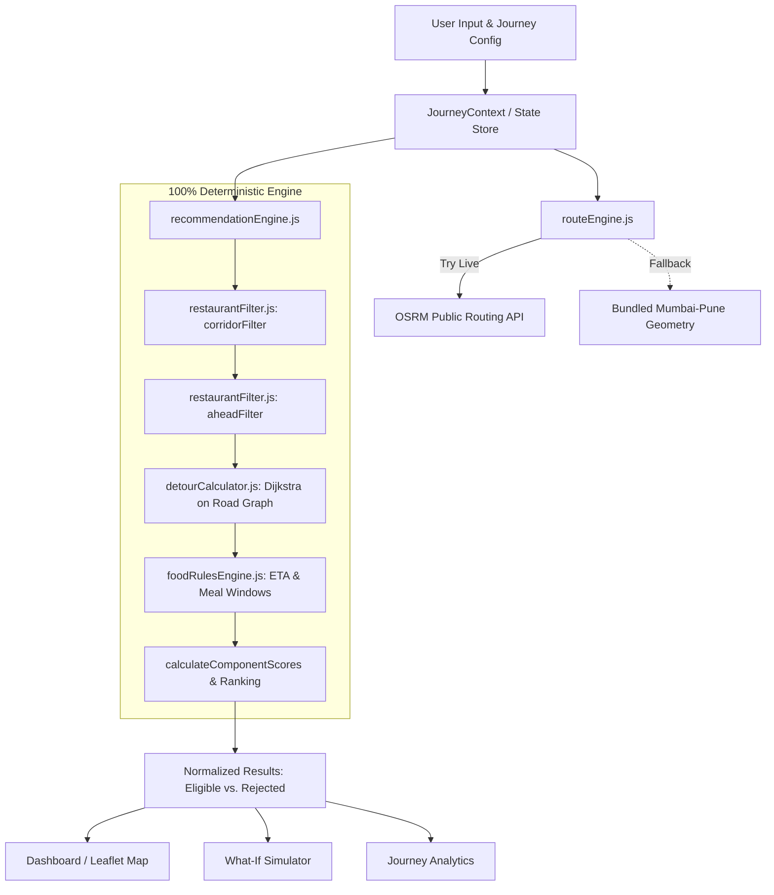

# WayDine — Smart Pitstop Intelligence & Route Optimization

> **"Your Journey. Your Direction. Your Perfect Pitstop."**  
> Route-aware, direction-aware highway restaurant discovery for the Mumbai → Pune Expressway (148.5 km).

WayDine ranks restaurants along a planned journey by how **convenient they actually are**, rather than naive straight-line proximity. It computes real road-network detours, penalizes illegal crossings and U-turns, matches meal windows to arrival ETAs, and scores candidates using a 100% deterministic algorithm.

**Hard Rule: ZERO AI/ML/LLMs.** Pure graph traversal, geospatial mathematics, and deterministic weighted scoring.

---

## Quick Start (3 Commands)

```bash
# 1. Install dependencies
npm install

# 2. Run test suite (50/50 unit & integration tests)
npm test

# 3. Start local development server
npm run dev
```

Open your browser at **`http://localhost:5173`**.

---

## Demo Walkthrough (Judge Flow)

1. **Landing Page (`/`)**:
   - Animated SVG corridor showing Mumbai → Pune highway with live route drawing and moving vehicle marker.
   - Explains the 4-step deterministic pipeline and clear sample data notice.
   - Click **"Plan Your Journey"** to enter the navigation dashboard.

2. **Navigation Dashboard (`/dashboard`)**:
   - Click **"Load Demo Journey"** in the top header or left panel.
   - Loads the 148.5 km Mumbai to Pune expressway route with 12 benchmark restaurants.
   - Center Leaflet map displays:
     - Green route polyline with 200 m corridor overlay.
     - Color-coded restaurant pins: **GREEN** (direct access), **YELLOW** (legal U-turn / junction), **RED** (opposite carriageway), and **Grey** (unverified road data).
   - Right panel ranks the Top 3 pitstops with scores, detour meters, and ETA.
   - Click any restaurant marker or card to preview its real road detour path.

3. **Explore Pitstops (`/pitstops`)**:
   - Filter by cuisine, dietary options (Veg, Vegan, Jain, Halal, GF), price tier (₹ to ₹₹₹), and maximum acceptable detour.
   - View categorized eligible stops vs. eliminated stops with explicit rejection reasons (`INACCESSIBLE_RED`, `CLOSED_AT_ETA`, `EXCESSIVE_DETOUR`).

4. **Restaurant Detail (`/restaurant/:id`)**:
   - Task 1: Direction-aware side analysis (left-hand driving convention) and accessibility badge.
   - Task 2: Real road graph detour breakdown (distance, time penalty, turn count, U-turn count).
   - Task 3: Interactive **Food Window Timeline** displaying meal windows (Breakfast, Lunch, Snacks, Dinner) and an exact ETA marker.

5. **What-If Simulator (`/simulator`)**:
   - Interactive vehicle scrubber along the 148.5 km expressway with Play/Pause and speed multiplier (0.5× to 10×).
   - Watch pitstop rankings and ETAs recalculate live as the vehicle advances.
   - Select up to 5 restaurants for side-by-side comparison with highlighted best values.
   - Adjust the stop duration slider (5–90 min) to evaluate total journey delay (e.g., `+28 min` to Pune arrival).
   - Click **"Choose This Stop"** to commit the pitstop to local selection history.

6. **Journey Analytics (`/analytics`)**:
   - 8 KPI cards: Total discovered, eligible, eliminated, accessibility distribution, and average detour.
   - 5 interactive Recharts visualizations:
     1. Accessibility class breakdown (Pie chart).
     2. Detour severity distribution (Bar chart).
     3. Score histogram (0–100 score distribution).
     4. Route density along the highway corridor (Stacked bar chart by KM bin).
     5. Available food categories at ETA (Horizontal bar chart).
   - Selection history list persisted in localStorage.

7. **Settings (`/settings`) & Preferences (`/preferences`)**:
   - Customize engine scoring weights (Detour 30%, Direction 25%, Road Access 20%, Food ETA 15%, Time 10%). Enforces `sum == 100` before applying.
   - Tune corridor width, detour thresholds, and turn penalties.
   - Instant live re-scoring upon applying new settings.

---

## Three Hackathon Tasks — Feature & File Mapping

| Hackathon Task | Visibly Demonstrable Feature | Implementation Files |
|---|---|---|
| **1. Route-aware, direction-aware discovery** | 200 m corridor filtering, vehicle progress check (ahead vs. behind), left-hand driving side detection, accessibility classification (`GREEN`, `YELLOW`, `RED`, `UNVERIFIED`). | [`src/engine/restaurantFilter.js`](file:///c:/Users/Vedika/Downloads/WayDine/src/engine/restaurantFilter.js)<br>[`src/engine/geoUtils.js`](file:///c:/Users/Vedika/Downloads/WayDine/src/engine/geoUtils.js) |
| **2. Detour and U-turn minimization** | Real road network detour distance & time via Dijkstra, physical median crossover checks, turn count & U-turn penalty additions, classified detour severity. | [`src/engine/shortestPath.js`](file:///c:/Users/Vedika/Downloads/WayDine/src/engine/shortestPath.js)<br>[`src/engine/detourCalculator.js`](file:///c:/Users/Vedika/Downloads/WayDine/src/engine/detourCalculator.js) |
| **3. ETA-based food recommendation** | Projected arrival time calculation per stop, opening hour checks (including past midnight), active food window category matching at ETA, deterministic 0–100 score. | [`src/engine/foodRulesEngine.js`](file:///c:/Users/Vedika/Downloads/WayDine/src/engine/foodRulesEngine.js)<br>[`src/engine/recommendationEngine.js`](file:///c:/Users/Vedika/Downloads/WayDine/src/engine/recommendationEngine.js) |

---

## Architecture Diagram



---

## Core Algorithms Explained

### 1. Haversine Distance
Computes great-circle distance between two spherical coordinates $(\phi_1, \lambda_1)$ and $(\phi_2, \lambda_2)$ with Earth radius $R = 6,371,000\text{ m}$:
$$a = \sin^2\left(\frac{\Delta\phi}{2}\right) + \cos(\phi_1)\cos(\phi_2)\sin^2\left(\frac{\Delta\lambda}{2}\right)$$
$$d = 2R \cdot \arcsin(\sqrt{a})$$
Used for candidate proximity checks and initial corridor gating.

### 2. Point-to-Segment Distance (Local Equirectangular Projection)
Calculates perpendicular distance from a restaurant $P$ to a route line segment $AB$. Converts coordinates into local Cartesian coordinates using standard projection:
$$x = \Delta\lambda \cdot \cos\left(\frac{\phi_A + \phi_B}{2}\right), \quad y = \Delta\phi$$
Clamps the projection parameter $t \in [0, 1]$ to segment bounds so distances to endpoints are strictly respected.

### 3. Cross-Product Bearing (Left-Hand Driving Convention)
Determines whether a restaurant is located on the vehicle's left (carriageway side in India) or right (oncoming/opposite carriageway):
$$\text{cross} = (x_B - x_A)(y_P - y_A) - (y_B - y_A)(x_P - x_A)$$
In India traffic drives on the **LEFT**. A positive cross product signifies the driver's side (direct access), while the opposite side requires median crossover validation or legal U-turn points.

### 4. Dijkstra Shortest Path with Turn & U-Turn Penalties
Traverses a directed road graph $G = (V, E)$ using a binary min-heap ($O((V + E) \log V)$).
- Enforces directed one-way highway edges.
- Detects turn types at junctions and forbids illegal U-turns across divided medians.
- Applies configurable penalties:
  $$\text{effective\_detour} = \text{graph\_dist}(V_{\text{veh}} \to P_{\text{access}}) + \text{graph\_dist}(P_{\text{access}} \to V_{\text{rejoin}}) - \text{original\_route\_dist}$$
  $$\text{penalty} = (N_{\text{turns}} \times \text{turn\_penalty}) + (N_{\text{uturns}} \times \text{uturn\_penalty})$$

### 5. Multi-Criteria Deterministic Scoring Formula
Ranks each eligible candidate on a transparent scale of 0 to 100 without machine learning:
$$\text{Score} = w_{\text{detour}} \cdot S_{\text{detour}} + w_{\text{direction}} \cdot S_{\text{direction}} + w_{\text{access}} \cdot S_{\text{access}} + w_{\text{food}} \cdot S_{\text{food}} + w_{\text{time}} \cdot S_{\text{time}}$$
- **Default Weights**: $30\% + 25\% + 20\% + 15\% + 10\% = 100\%$.
- Transparent, reproducible, and configurable via `/settings`.

---

## Expected Benchmark Results (Mumbai → Pune Demo)

| # | Restaurant Name | Category / Diet | Access Class | Detour Class | Expected Outcome & Rationale |
|---|---|---|---|---|---|
| 1 | **Cafe Kalamboli Express** | Quick Bites, Veg | `GREEN` | Excellent | Top recommendation. Direct ramp access, 180 m detour, active menu. |
| 2 | **Highway King Dhaba** | North Indian, Veg/Halal | `GREEN` | Very Good | Direct access on driver side, 450 m detour. |
| 3 | **Pune Misal House** | Snacks / Maharashtrian | `GREEN` | Moderate | Direct left approach, 950 m detour. |
| 4 | **The Pit Stop Cafe** | Coffee & Burgers | `YELLOW` | Moderate | Requires junction exit and legal U-turn (1.1 km detour). |
| 5 | **Mumbai Street Bites** | Fast Food | `YELLOW` | High | Long highway diversion with 2 right turns (2.1 km detour). |
| 6 | **Opposite Bites** | Fast Food | `RED` | Excessive | **Eliminated (`INACCESSIBLE_RED`)**. On opposite carriageway behind concrete median. |
| 7 | **Garden Veg Restaurant** | Vegetarian | `UNVERIFIED` | — | **Flagged as Unverified**. Excluded from accessible graph traversal. |
| 8 | **Highway Breakfast Spot** | Breakfast | `GREEN` | Excellent | Open early morning; eligible if ETA is before 11:00 AM. |
| 9 | **Late Night Dhabha** | Punjabi, Halal | `GREEN` | Very Good | Operating hours extend past midnight (02:00 AM closing). |
| 10 | **The Biryani Stop** | Mughlai | `GREEN` | Moderate | **Eliminated (`CLOSED_AT_ETA`)** if ETA falls outside lunch window. |
| 11 | **Budget Bites Express** | Quick Bites, ₹ tier | `GREEN` | Excellent | Top score for budget-conscious profiles with direct access. |
| 12 | **Premium Highway Lounge** | Continental, ₹₹₹ tier | `GREEN` | High | Higher detour distance but passes all directional rules. |

---

## Data Sources & Provenance

Every data point in WayDine is clearly tagged in the user interface:
- **Live (OSRM/OSM)**: Real-time highway geometry fetched dynamically via OSRM public routing API (`https://router.project-osrm.org`).
- **Demo Fallback**: Offline high-resolution coordinates of the Mumbai–Pune Expressway bundled directly with the application.
- **Sample/Demo Seed**: 12 benchmark restaurants, access nodes, and local road graph connecting junctions, flyovers, and service lanes.
- **Database (Optional)**: Full schema provided in `supabase/schema.sql` supporting PostGIS spatial indices and user preferences.

---

## Limitations

1. **Road Graph Scope**: The embedded road graph covers key junctions along the Mumbai–Pune corridor for benchmark testing rather than a full national graph.
2. **Sample Listings**: Restaurant opening times, prices, and food availability are sample data models designed for hackathon demonstration.
3. **OSRM Rate Limits**: The public demo OSRM server may rate-limit high-frequency requests; the app automatically falls back to bundled geometry without crashing.
4. **Unverified Policy**: Any restaurant lacking road graph linkage is strictly labelled **"Unverified"** in grey — never claimed to be accessible.

---

## License

Built for hackathon demonstration. All sample data and code are distributed under the MIT License.
